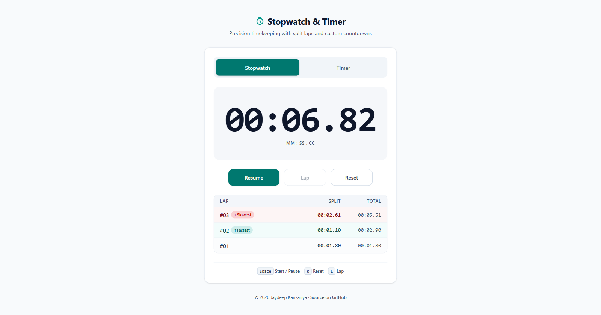
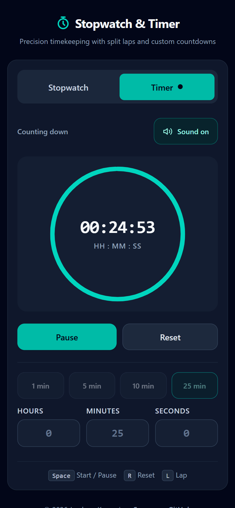

# Stopwatch & Timer App

A standalone, accessible **Stopwatch and Countdown Timer** web application built with React, TypeScript (strict), Vite, and Tailwind CSS v4. It tracks time from timestamps rather than counting ticks, so it stays accurate even when the browser tab is in the background.

**Live:** https://stopwatch-timer-rust.vercel.app/

| Stopwatch with laps (desktop, light) | Timer running (mobile, dark) |
|---|---|
|  |  |

---

## Overview

**Stopwatch & Timer** combines a centisecond-precision stopwatch (with split/lap tracking and fastest/slowest lap detection) and a customisable countdown timer (with quick presets, an SVG progress ring, Web Audio API completion chime, and `localStorage` persistence) inside a responsive, keyboard-accessible single-page interface. Both clocks preserve their state and continue running accurately across tab switches and background browser throttling.

---

## Features

- **Accessible Two-Mode Tab Control:** WAI-ARIA `tablist` / `tab` / `tabpanel` pattern with roving `tabIndex` and `ArrowLeft` / `ArrowRight` / `Home` / `End` keyboard navigation.
- **Persistent Dual-Clock State:** Switching between Stopwatch and Timer never loses or resets a running or paused clock; active tab indicators and `document.title` reflect running clocks in real time.
- **Stopwatch:**
  - Displays `MM:SS.cc` under one hour and automatically expands to `HH:MM:SS.cc` at one hour and beyond (`tabular-nums`).
  - **Start / Pause / Resume**, **Lap**, and **Reset** controls with proper disabled states.
  - Scrollable newest-first lap table showing lap number, split time, and total elapsed time, highlighting the **Fastest** (`↑ Fastest`) and **Slowest** (`↓ Slowest`) laps once 3 or more laps are recorded.
- **Countdown Timer:**
  - Custom **Hours** (`0–99`), **Minutes** (`0–59`), and **Seconds** (`0–59`) inputs with strict sanitisation and clamping for typed and pasted values.
  - Inline accessible error (`aria-describedby`) when total duration is `0`, locking **Start**.
  - Quick preset buttons (**1 min**, **5 min**, **10 min**, **25 min**) enabled while idle.
  - Circular SVG progress ring (`role="progressbar"`) and ceiling-rounded `HH:MM:SS` countdown display that shows `00:00:01` until the timer truly reaches `0`.
  - Completion alert (`"Time's up"`), polite screen-reader announcement (`"Timer finished"`), synthesized Web Audio API chime (unlocked on user gesture), and persistent **Mute** toggle (`aria-pressed`).
  - Remembers last entered duration and mute preference in `localStorage` with safe validation and fallback defaults.
- **Responsive & Theme-Aware:** Works cleanly from 360 px mobile screens up to desktop viewports, supporting system Light and Dark modes (`prefers-color-scheme`) and `prefers-reduced-motion`.

---

## Tech Stack

- **Framework:** React 19 (with `<StrictMode>` enabled)
- **Build Tool:** Vite
- **Language:** TypeScript (strict mode, zero `any`)
- **Styling:** Tailwind CSS v4 (`@tailwindcss/vite`)
- **Linter:** Oxlint
- **Tests:** Vitest (pure time helpers, lap logic, and the stopwatch and timer reducers)

---

## How to Run

```bash
# Install dependencies
npm i

# Start local development server
npm run dev

# Run TypeScript check and production build
npm run build

# Run linter
npm run lint

# Run unit tests
npm test
```

---

## Project Structure

```text
src/
  main.tsx                  # React root with <StrictMode>
  App.tsx                   # Header, tabs, owns stopwatch + timer hooks, live region, footer
  index.css                 # @import "tailwindcss"; plus base styles
  types.ts                  # Shared TypeScript interfaces and union types
  lib/
    time.ts                 # Pure time formatting, conversion, and input clamping helpers
    laps.ts                 # Pure fastest/slowest lap calculation
    beep.ts                 # Shared Web Audio API chime and gesture unlock helper
    storage.ts              # Safe localStorage read/write with runtime validation
    time.test.ts            # Unit tests: formatting, rounding, clamping, 99:59:59
    laps.test.ts            # Unit tests: fastest/slowest lap detection
  hooks/
    useNow.ts               # High-resolution ticking timestamp while a clock is active
    useStopwatch.ts         # Pure reducer + derived stopwatch state and lap actions
    useTimer.ts             # Pure reducer + derived countdown state, persistence, finish handler
    useDocumentTitle.ts     # Throttled (~1 Hz) document.title updates while running
    useShortcuts.ts         # Global Space / R / L keyboard shortcuts
    clockReducers.test.ts   # Unit tests: stopwatch and timer reducers
  components/
    Tabs.tsx                # Accessible tablist with roving tabIndex and arrow keys
    TimeDisplay.tsx         # Responsive tabular-nums hero display
    Controls.tsx            # Reusable Start/Pause/Resume, Lap, and Reset button bar
    Stopwatch.tsx           # Stopwatch panel view
    LapList.tsx             # Scrollable lap table with fastest/slowest badges
    Timer.tsx               # Timer panel view with mute button and finished alert
    TimerInputs.tsx         # Sanitised Hours / Minutes / Seconds fields
    Presets.tsx             # 1 / 5 / 10 / 25 minute preset buttons
    ProgressRing.tsx        # SVG circular progress indicator
public/og-image.png         # Link-preview image (also used in this README)
docs/                       # README screenshots
```

---

## How Timekeeping Works

Neither the stopwatch nor the timer increments or decrements a counter on ticks. The stopwatch records `accumulatedMs` and a `startedAt` timestamp from `performance.now()`, deriving elapsed time on each render as `accumulatedMs + (running ? now - startedAt : 0)`. The countdown timer stores an absolute target timestamp `endAt = now + remainingMs` while running and derives remaining time as `Math.max(0, endAt - now)`, storing `remainingMs` on pause and recomputing `endAt` on resume. A shared `useNow` hook uses `requestAnimationFrame` while the page is visible and a 40 ms interval only while it is hidden (when the browser pauses animation frames), switching between the two on `visibilitychange`. It exists strictly to trigger re-renders while a clock is active, so there is zero drift even when the browser tab is hidden or throttled.

---

## Keyboard Shortcuts

Shortcuts are ignored while typing in a text field (`input`, `textarea`, `select`). `Space` is also ignored when a button, tab, or link has focus, because the browser already activates the focused control. `R` and `L` keep working after you click a button. Key repeats and modifier combinations (`Ctrl`, `Alt`, `Meta`) are ignored.

| Key | Action |
|---|---|
| `Space` | Start, Pause, or Resume the active tab's clock (prevents page scroll) |
| `R` | Reset the active tab's clock |
| `L` | Record a lap (when on the Stopwatch tab and running) |
| `←` / `→` | Switch between Stopwatch and Timer tabs when focus is on the tab bar |

---

## Decisions

- **Default Timer Duration:** When `localStorage` has no saved duration (or is unavailable/corrupt), the timer defaults to **5 minutes** (`00:05:00`) with sound unmuted (`muted: false`).
- **Negative and Decimal Input Sanitisation:** Negative strings (such as `-5`) are clamped to the minimum `0`, decimal values (such as `1.5`) truncate at the decimal point to their integer part (`1`), non-numeric strings (`abc`) resolve to `0`, and values above the field maximum (`999`) clamp to `99` (Hours) or `59` (Minutes/Seconds).
- **Fastest / Slowest Lap Highlighting:** Once 3 or more laps exist and splits are not all identical, the fastest split is styled in teal with an `↑ Fastest` badge and the slowest split is styled in red with a `↓ Slowest` badge so distinction never relies on colour alone.
- **Document Title Throttling:** `useDocumentTitle` keys its effect on whole seconds (`Math.ceil(remainingMs / 1000)` for Timer and `Math.floor(elapsedMs / 1000)` for Stopwatch), updating `document.title` at most once per second and preferring the Timer if both clocks are running simultaneously.

---

- **Editing After Finish:** Once the timer reaches `Time's up`, the Hours / Minutes / Seconds inputs and presets unlock immediately and any edit returns the timer to idle with the new duration. Each fresh run has its own `runId`, so the completion chime plays exactly once per run, even under `<StrictMode>`.

---

## Deployment (Vercel)

| Setting | Value |
|---|---|
| Framework Preset | **Vite** |
| Root Directory | `./` (repo root) |
| Build Command | `npm run build` |
| Output Directory | `dist` |
| Install Command | `npm install` |
| Node.js version | latest LTS |

No environment variables are needed.
